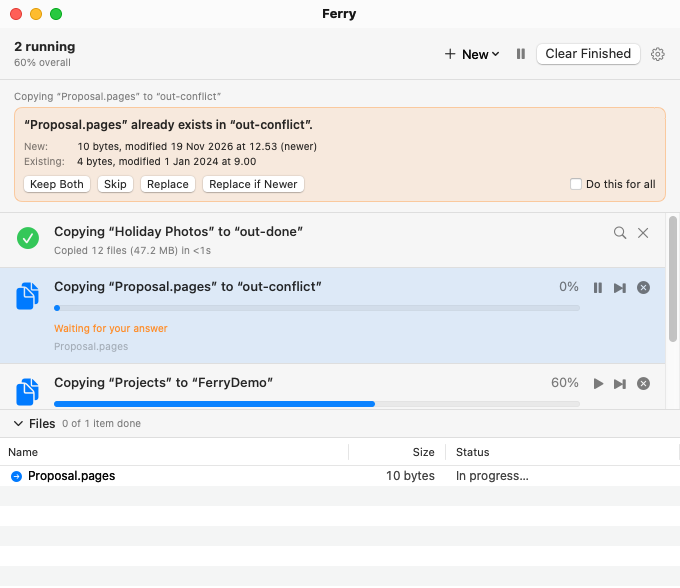

# Ferry

A small, native file copier for macOS in the spirit of [Ultracopier](https://github.com/alphaonex86/Ultracopier) and TeraCopy: a transfer queue with pause, resume, skip and stop, conflict handling, error retry, verification and a live file list. It lives in the menu bar and works from Finder's right-click menu.

Swift, AppKit and SwiftUI with no third-party dependencies. It builds with the Command Line Tools alone; you don't need Xcode.



## What changed compared with Ultracopier on macOS

| Ultracopier on macOS | Ferry |
|---|---|
| Tray icon is a fixed-colour bitmap and is easy to lose in a dark or tinted menu bar | Template SF Symbol that adapts to every menu bar. During a transfer it becomes a progress ring with a percentage. It can't be ⌘-dragged out by accident, and you can drop files on it. |
| No Finder integration | On the startup disk, a Finder extension adds **Paste with Ferry**, **Move Here with Ferry**, **Paste/Move into Folder**, **Copy To…** and **Move To…** to the right-click menu, plus an optional toolbar button. Everywhere else (external drives, iCloud Drive, OneDrive, Dropbox), macOS Services provide the same actions under *Quick Actions / Services*. See the note below on why external drives are left out. |
| Opening the app shows a file picker | Opening the app shows the **transfer list**. Double-clicking it again while it runs brings the list back. |
| Qt app, roughly 40 MB of frameworks | 2.5 MB app; about 14 MB of memory and 0% CPU when idle in the menu bar |
| Dock icon is always shown | **No Dock icon** unless a Ferry window is open (`LSUIElement`, plus switching the activation policy while a window is open) |
| — | Optional: **hide the menu bar icon when not in use** (Settings › Ferry). It appears only while something is queued, copying or waiting for an answer. Open Ferry from Spotlight, Launchpad or Applications to get the window back. |

## “Can Ferry be the default copy handler?”

**Not truly, because macOS has no API for it.** On Windows, TeraCopy registers a shell copy hook and Explorer hands copies over. Finder's copy engine is private, and drag-and-drop between Finder windows can't be redirected at all. Replacing it would mean patching Finder, which System Integrity Protection blocks.

What Ferry does instead (all optional):

1. **⌘V / ⌥⌘V takeover in Finder** (*Settings › Finder › Handle ⌘V and ⌥⌘V in Finder*). This is the closest thing to a default handler. Copy files in Finder with ⌘C as usual. When you press ⌘V (copy) or ⌥⌘V (move) in Finder, Ferry handles the paste into the folder Finder would have used. It only steps in when Finder is in front, the clipboard holds files, and you're not typing in a text field (renaming, search, Go to Folder). In every other case, or if anything goes wrong, the keystroke goes to Finder unchanged. It needs **Accessibility** (to see the keystroke) and **Automation → Finder** (to ask Finder for the current folder). Settings shows both permissions and has buttons to grant them.
2. **Right-click menu** (Finder extension) and **Services**, as described above.
3. **Drop files on the menu bar icon** or on the Ferry window, then pick a destination. Hold ⌥ to move instead of copy.
4. **`ferry-cli`**, which ships inside the app: `Ferry.app/Contents/MacOS/ferry-cli copy|move [--verify] [--on-conflict skip|replace|newer|keep-both] SRC… DEST`.

Drag-and-drop inside Finder still uses Finder's own copier. No public mechanism can change that.

**Why the extension's menu stops at the startup disk.** A Finder extension only appears in folders it has said it watches, and watching `/` doesn't carry over to other drives. To reach an external drive, the extension would have to watch that drive's root folder. When it does, Finder replaces the drive's icon in the sidebar with Ferry's icon, and no API turns that off. Ferry therefore leaves drive icons alone and relies on Services and the ⌘V takeover on external drives. If you'd rather have the full menu on every drive and accept the icon change, list the mounted volumes in `directoryURLs` in `FinderExtension/FinderSync.swift`.

## Does Swift make it faster than Qt?

Raw throughput is mostly limited by the disks, not the language, so rewriting the same loop in Swift wouldn't be much faster than C++/Qt. The speed comes from using macOS-specific I/O:

- **APFS clones** (`clonefile`) for copies on the same volume: instant, and they use no extra space (Finder does the same).
- **Renames** for moves on the same volume, done once per top-level item when possible.
- **Overlapped reading and writing** for large files. A reader thread and a writer share a ring of three 4 MB page-aligned buffers with `F_NOCACHE`, so a large copy reads and writes at the same time and doesn't push the rest of your work out of the file cache.
- **`copyfile(3)`** for small files and HFS-compressed files, which has the lowest overhead per file.
- **Full metadata:** permissions, flags (including locked files), ACLs, extended attributes, tags, resource forks, creation and modification dates. Qt's file API loses most of this on macOS.

What Swift does buy is the size and the native feel: no bundled frameworks, a fast launch, and a small memory footprint.

Measured on this Mac (Apple silicon, APFS):

| Test | Ferry | Reference |
|---|---|---|
| 400 MB file, same SSD, forced byte copy | 0.07 s (≈ 6 GB/s) | `cp` 0.11 s |
| 400 MB file, same volume, clone | instant | `ditto` instant |
| 2,765 small files (187 MB) to another APFS volume | 0.70–1.04 s | `ditto` 0.61–1.02 s, `cp -Rp` 0.98 s |

## Features

- A queue: jobs run one at a time, because parallel copies to one disk are slower. **Start now** runs a queued job alongside the current one.
- Pause, resume, skip the current file, stop. A stopped copy never leaves a half-written file: data goes to a hidden temp file that is renamed into place when complete. Small new files are written in place, and their partial data is removed if they're interrupted.
- Conflicts: *Ask*, *Replace*, *Replace if newer*, *Skip*, *Keep both* (Finder-style "name 2"), with *Do this for all*. Folders merge. Pasting into the folder an item is already in makes "name copy", as Finder does.
- Errors: *Ask* (Try Again, Skip, Stop, Skip all) or *Skip and log*. Problems are listed per file and can be copied to the clipboard as a report.
- Checks free space before starting, and warns rather than failing halfway.
- Optional **verification**: the SHA-256 of the source is computed while it's being read, then the copy is re-read from disk and compared.
- Notifications when a transfer finishes in the background, and *Open at login*.
- A file list built on NSTableView that only draws visible rows, so a million-file job costs no more to display than a ten-file one. It shows each file's full source and destination path (including the new name when *Keep both* renamed it) and follows the file being copied. Scroll away and it stops following; scroll back to the active file and it resumes.
- Hidden `._` metadata files (used by SMB shares, FAT and exFAT to store tags and other attributes) are not copied as separate files: their contents travel with the file they belong to, as Finder does it.
- Folders are copied in Finder's order (case-insensitive, with numbers compared by value, so "Lecture 2" comes before "Lecture 10").

## Build and install

You need the Command Line Tools (`xcode-select --install`) and macOS 13 or later.

```bash
scripts/build.sh
```

That builds into `~/Library/Caches/FerryBuild/Ferry.app`. Build products stay out of this folder so a synced folder doesn't churn on them.

```bash
scripts/build.sh install
```

That builds, copies Ferry to `/Applications` (or `~/Applications`), registers it, enables the Finder extension and opens Ferry. If the right-click items don't appear straight away, relaunch Finder (⌥-right-click Finder in the Dock › Relaunch) or switch the extension on in *System Settings › General › Login Items & Extensions › Extensions › Finder*. On macOS 26 and later, also check *System Settings › Menu Bar* to make sure Ferry is allowed in the menu bar.

Options: `ARCHS="arm64 x86_64"` for a universal build, `SIGN_IDENTITY="Developer ID Application: …"` to sign for distribution (this also turns on the hardened runtime), and `BUNDLE_ID=…`.

```bash
swift test --scratch-path ~/Library/Caches/FerryBuild/spm-test \
  -Xswiftc -plugin-path -Xswiftc /Library/Developer/CommandLineTools/usr/lib/swift/host/plugins/testing
```

That runs the engine tests.

### Signing and permissions

With no signing identity available, the build is **ad-hoc signed**. That's fine on your own Mac, but macOS ties Accessibility and Automation grants to the exact binary, so after a rebuild you'll need to grant them again (only relevant to the ⌘V takeover). To avoid that, create a self-signed "Code Signing" certificate in Keychain Access (*Certificate Assistant › Create a Certificate…*) and build with `SIGN_IDENTITY="That Name" scripts/build.sh install`.

### Renaming the app

The name "Ferry" lives in `scripts/build.sh` (`APP_NAME`, `BUNDLE_ID`), `Resources/*.plist` and a handful of user-facing strings. Change those and rebuild.

## How it fits together

```
Sources/FerryCore/          UI-free engine (also used by ferry-cli and the tests)
  JobRunner.swift           plan → space check → transfer → folder metadata; collisions, retries, moves
  FileCopier.swift          clone / copyfile / pipelined copy, verify, atomic finish
  Job.swift                 progress counters, pause/skip/cancel, prompts, file list storage
  TransferQueue.swift       sequential queue
Sources/Ferry/              the menu bar app
  AppController.swift       windows, Dock icon policy, actions, refresh loop (only while transferring)
  StatusItemController.swift  menu bar icon, menu, drop target
  Views/                    SwiftUI transfer list, prompts, settings; NSTableView file list
  Integration/              Finder ⌘V takeover, Services, URL requests from the extension, Finder bridge
FinderExtension/            Finder Sync extension (sandboxed; forwards requests to the app)
Resources/                  Info.plists, entitlements, icon (scripts/make-icon.swift draws it)
scripts/build.sh            build, bundle, sign, install
```

The Finder extension talks to the app through `ferry://` URLs that carry a random per-machine token, which the build writes into both Info.plists. A web page or another app can't use the URL scheme to make Ferry move files.

One build note: in the current SDK, SwiftUI's `@State` is a compiler macro whose plugin ships only with Xcode, so the views keep their state in small `ObservableObject`s instead. That's what lets the project build with the Command Line Tools alone.
